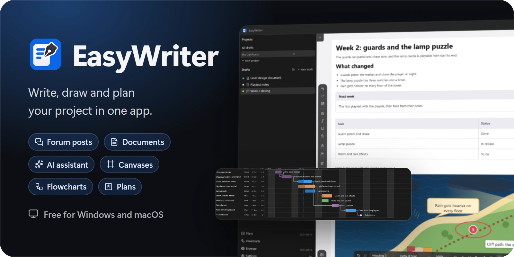
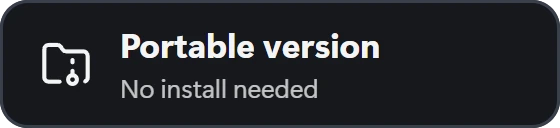
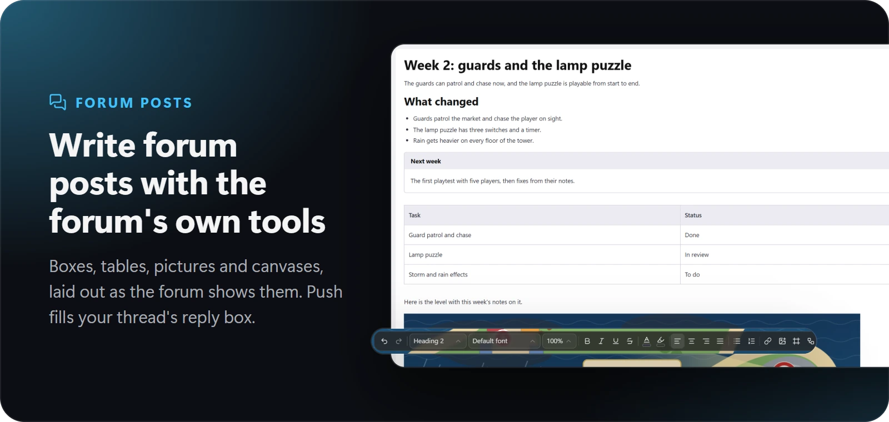
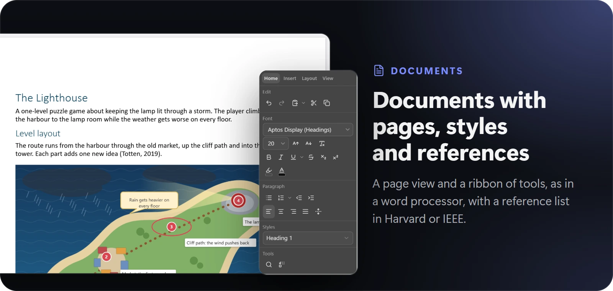
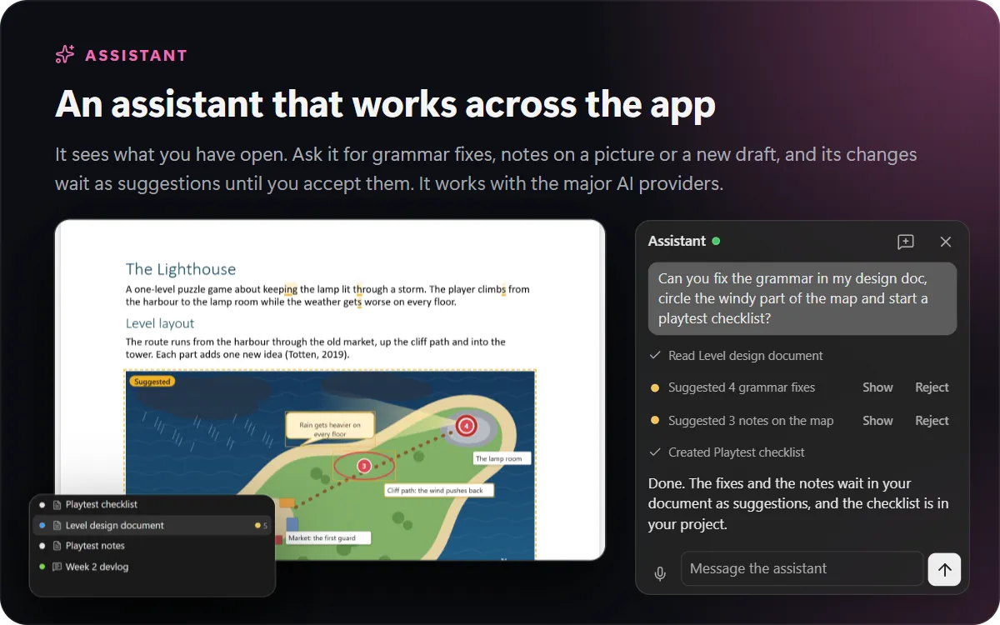
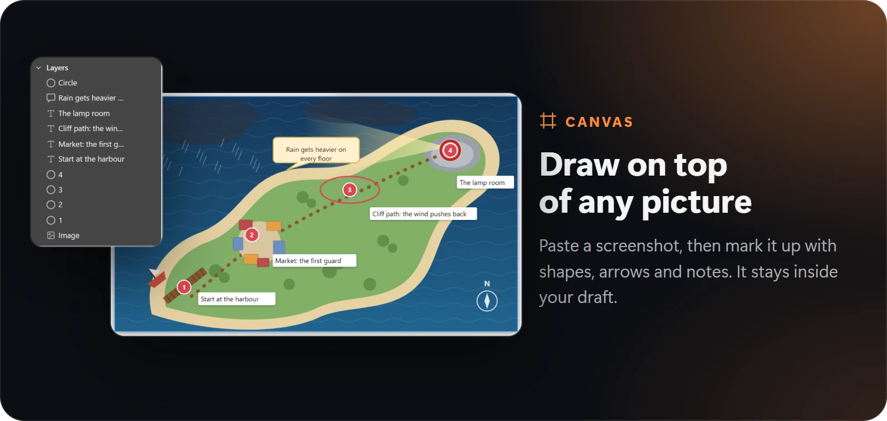
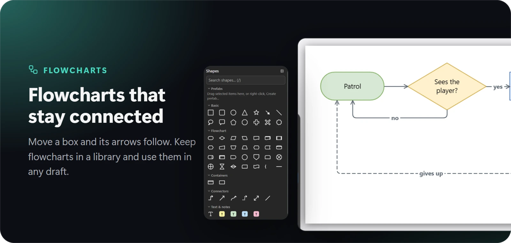
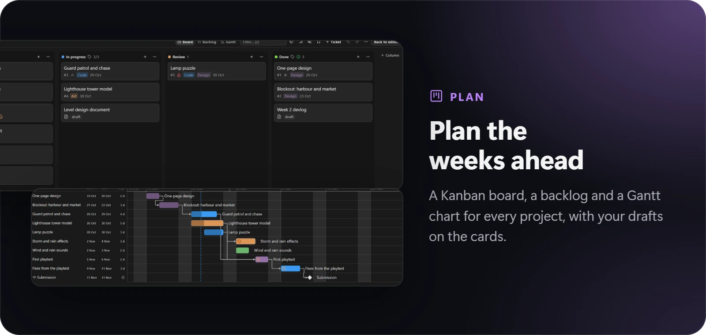
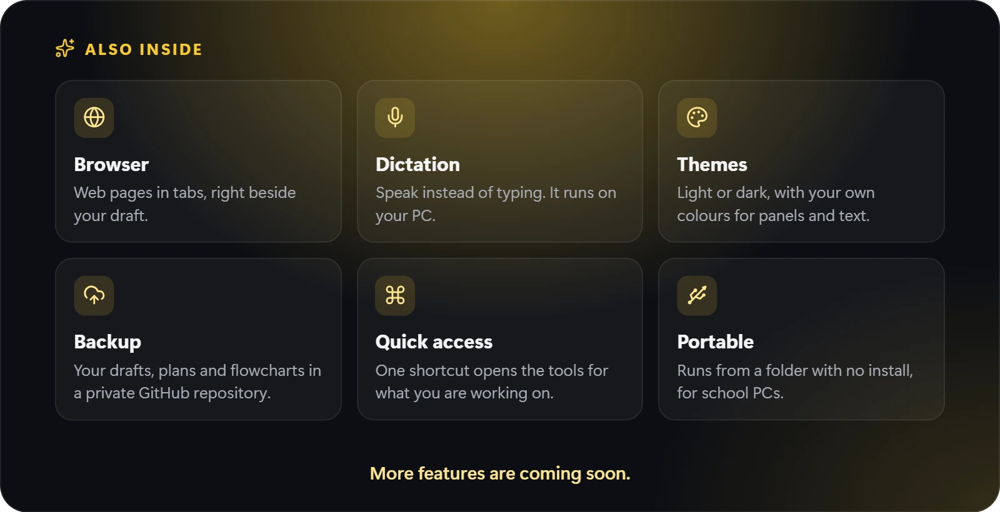

<!-- The pictures in docs/img come from `npm run readme-art` (scripts/readme-art.js). Run it again when the app's look changes.
     The download links name no version: every release has EasyWriter-Setup.exe and EasyWriter-Portable.zip. -->

<p align="center">
  
</p>

<p align="center">
  <a href="https://github.com/DashingNights/EasyWriter/releases/latest/download/EasyWriter-Setup.exe"></a>&nbsp;&nbsp;<a href="https://github.com/DashingNights/EasyWriter/releases/latest/download/EasyWriter-Portable.zip"></a>
</p>

<p align="center">
  <a href="https://github.com/DashingNights/EasyWriter/releases/latest"></a><br>
  Free, for Windows 10 and 11. It keeps itself up to date.<br>
  <a href="https://github.com/DashingNights/EasyWriter/releases/latest">What's new</a> · <a href="#good-to-know">Installer or portable?</a>
</p>

EasyWriter is a Windows app for writing up your projects. Forum posts and documents hold canvases, flowcharts and plan charts next to their text, and an AI assistant can help anywhere in the app.

<p></p>
<p></p>
<p></p>
<p></p>
<p></p>
<p></p>
<p></p>

## Good to know

<details>
<summary><b>Installer or portable?</b></summary>

Take the installer if you can install apps on your PC. Run `EasyWriter-Setup.exe` and follow the steps.

Take the portable version on a PC that blocks installers, such as a school computer. Extract `EasyWriter-Portable.zip` anywhere you can save files, such as the Desktop or a USB stick, and run `EasyWriter.exe` inside it.
</details>

<details>
<summary><b>Windows says it protected your PC</b></summary>

EasyWriter is not code-signed, so Windows SmartScreen may stop it the first time it runs. Click **More info**, then **Run anyway**.
</details>

<details>
<summary><b>The download is blocked</b></summary>

Some school networks block downloads in the browser. Make an empty folder, type `cmd` in the address bar of File Explorer in that folder and press Enter, then run this line. It downloads the portable version and extracts it there.

```
curl.exe -L -o EasyWriter.zip https://github.com/DashingNights/EasyWriter/releases/latest/download/EasyWriter-Portable.zip && tar -xf EasyWriter.zip
```
</details>

<details>
<summary><b>Updates</b></summary>

Both versions check for a new version and download it in the background. When it is ready, EasyWriter shows a Restart button, and it saves your open draft before it restarts. The [releases page](https://github.com/DashingNights/EasyWriter/releases) lists what changed in each version.
</details>

<details>
<summary><b>Where your work is saved</b></summary>

The installed version keeps everything in `%APPDATA%\EasyWriter`. The portable version keeps everything in the `data` folder next to `EasyWriter.exe`, so take that folder with you when you move the app.

For a copy somewhere else, turn on GitHub backup. Your drafts, plans and flowcharts then go to a private repository of your own.
</details>

<details>
<summary><b>Which AI providers the assistant works with</b></summary>

ChatGPT and Claude through Codex and Claude Code, or Google Gemini, DeepSeek and Qwen with your own API key. Pick one in Settings. The assistant stays off until you do, and its edits wait as suggestions unless you let it apply them straight away.
</details>

<details>
<summary><b>Which forums it works with</b></summary>

Invision Community forums. Turn the forum integration on in Settings, link a project to your thread, and Push fills the thread's reply box with your draft, canvases as pictures. You press Submit on the forum yourself.
</details>

## Build from source

You need Windows and Node.js 22 or newer.

```
npm install
npm start
```

`npm start` builds the app and opens it. `npm run dist` builds the installer and the portable zip into the `release` folder.

## Licence

The source is published so that you can read and review it. It is not open source, and you may not copy, change or redistribute it without written permission. You may download the official release builds and run them for your own use. See [LICENSE](LICENSE).
