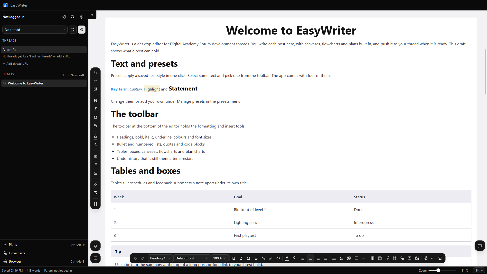
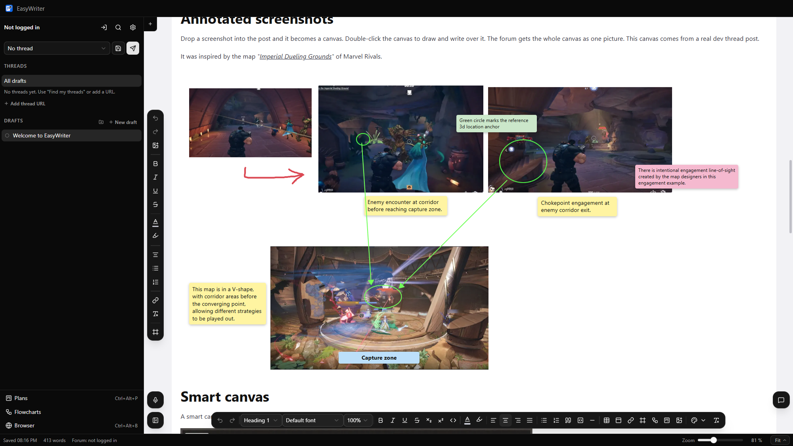
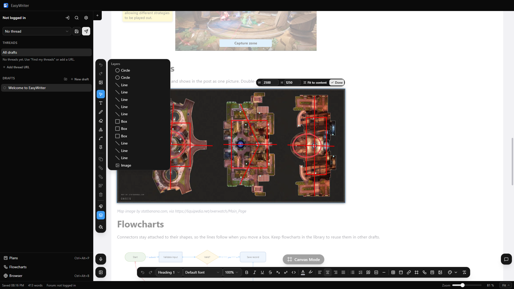
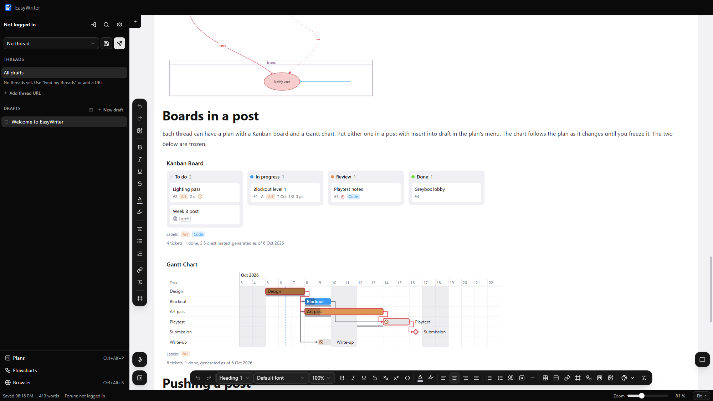
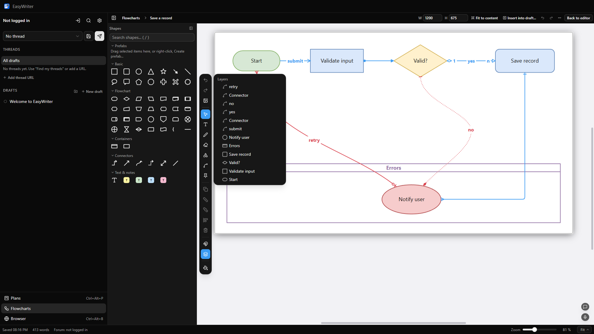
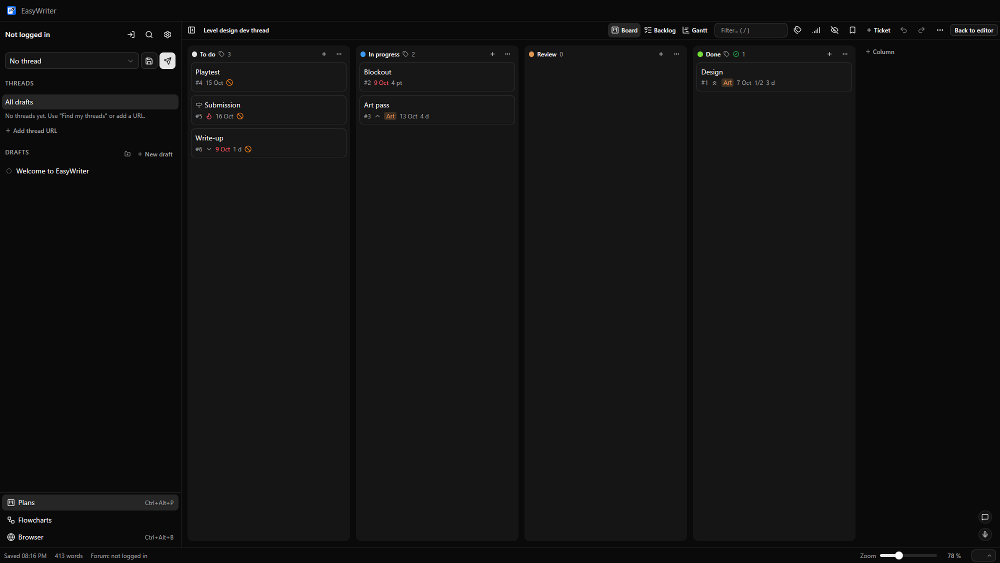
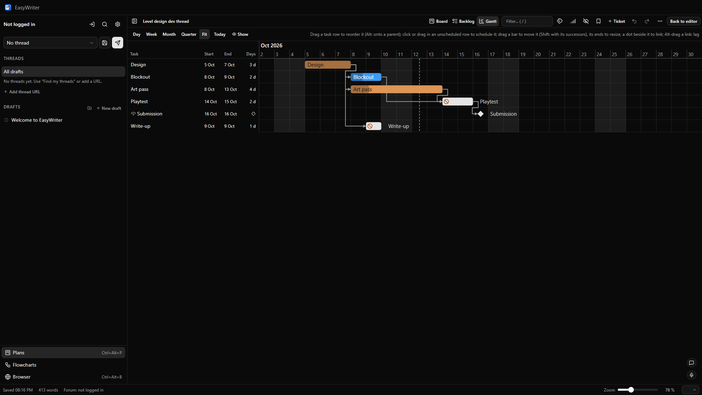

# Download
Download installer: [EasyWriter-Setup-x.x.x.exe](https://github.com/DashingNights/EasyWriter/releases/latest) \
Download Portable (school computers): [EasyWriter-x.x.x-win.zip](https://github.com/DashingNights/EasyWriter/releases/latest)

# EasyWriter

EasyWriter is a Windows desktop editor for project writing, with canvases, flowcharts and plans built in. Drafts belong to projects. An optional integration links projects to threads of an Invision Community forum.



## What it does

- A rich text editor with headings, lists, quotes, code blocks and tables. Text presets apply a saved style in one click.
- Canvases inside a draft for pictures, text and shapes.
- Annotate screenshots. Drop a screenshot into a draft, then double-click the canvas it makes to draw and write over it.
- Flowcharts whose connectors stay attached to their shapes. Keep them in the flowchart library to reuse them in other drafts.
- A plan for each project, with a Kanban board, a backlog and a Gantt chart. A chart of the plan can go into a draft.
- A browser with tabs inside the app, so your references stay next to the draft.
- Dictation with Whisper, which runs on your own computer.
- A chat assistant that can read and edit your drafts. It uses your own key for Qwen Cloud, Google Gemini or DeepSeek.
- GitHub backup. Sign in with GitHub and EasyWriter keeps your drafts, plans and flowcharts in a private repository of your own.

On the first start EasyWriter opens a welcome draft that shows these features. Delete it from the sidebar when you no longer need it.

## Screenshots

Screenshots from a real project draft on a canvas, with drawings and notes over them.



A smart canvas open in Canvas Mode, where it is edited in place.



A plan's Kanban board and Gantt chart inside a draft.



The flowchart library, where flowcharts are drawn and kept for reuse.



The Kanban board of a project's plan.



The same plan as a Gantt chart, with the links between tasks.



## Forum integration

Turn it on in Settings > Integrations. It is off on a new install, and on for a profile that already links forum threads.

- Link a project to a thread of an Invision Community forum. EasyWriter reads the thread's title and breadcrumb.
- Push to forum fills the thread's reply box with the draft, canvases as pictures. You press Submit on the forum yourself.
- Drafts get the forum post width (Settings > Forum) and the titled box insert.
- The forum opens in its own window, which keeps your sign-in. Turning the integration off keeps the sign-in and every link.

## Download

Get EasyWriter from the [Releases page](https://github.com/DashingNights/EasyWriter/releases). There are two downloads.

- **EasyWriter-Setup-x.y.z.exe** is the installer, for a normal PC. Run it and follow the steps.
- **EasyWriter-x.y.z-win.zip** is the portable copy, for PCs that block installers. Extract it anywhere you can write to, such as the Desktop, and run EasyWriter.exe. Everything it saves, your drafts included, lives in the `data` folder next to EasyWriter.exe, so keep that folder when you move the app.

EasyWriter is not code-signed, so Windows SmartScreen may warn you the first time you run it. Click **More info**, then **Run anyway**.

You can also download the portable copy without the warning. Make an empty folder, type `cmd` in the File Explorer address bar of that folder and press Enter, then run this line. It gets version 0.1.0, which updates itself to the newest version after it starts.

```
curl.exe -L -o EasyWriter.zip https://github.com/DashingNights/EasyWriter/releases/download/v0.1.0/EasyWriter-0.1.0-win.zip && tar -xf EasyWriter.zip
```

## Updates

The installed copy and the portable copy both update themselves from GitHub Releases. When a new version has downloaded, EasyWriter shows a Restart button. It saves your open draft before it restarts.

## Where your data lives

- Installed copy: `%APPDATA%\EasyWriter`
- Portable copy: the `data` folder next to EasyWriter.exe

## Build from source

You need Windows and Node.js 22 or newer.

```
npm install
npm start
```

`npm start` builds the app and opens it. `npm run dist` builds the installer and the portable zip into the `release` folder.

## Licence

The source is published so that you can read and review it. It is not open source, and you may not copy, change or redistribute it without written permission. You may download the official release builds and run them for your own use. See [LICENSE](LICENSE).
